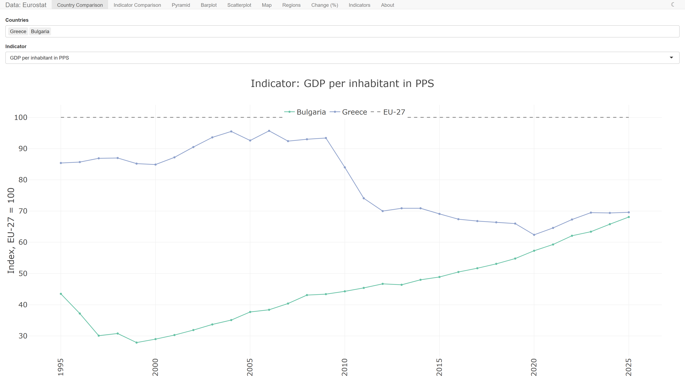
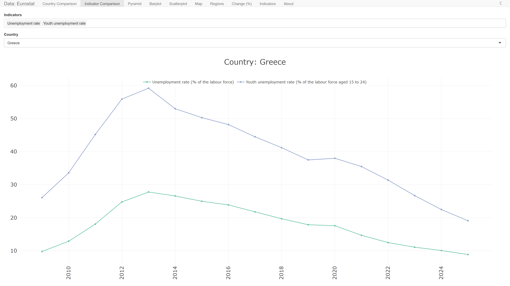
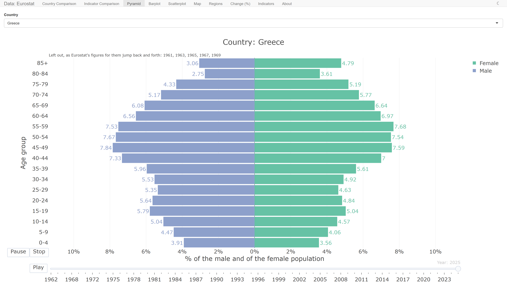
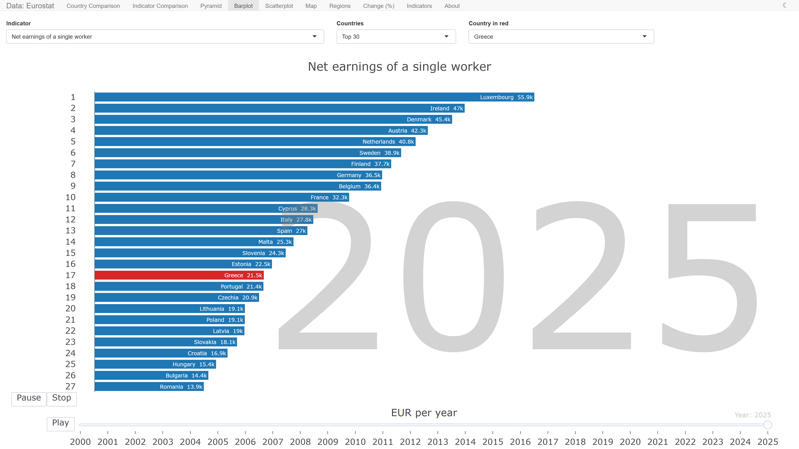
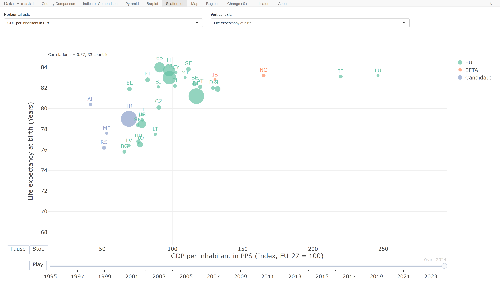
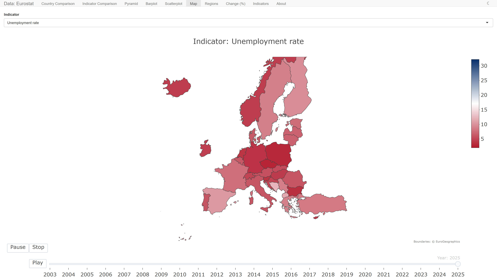
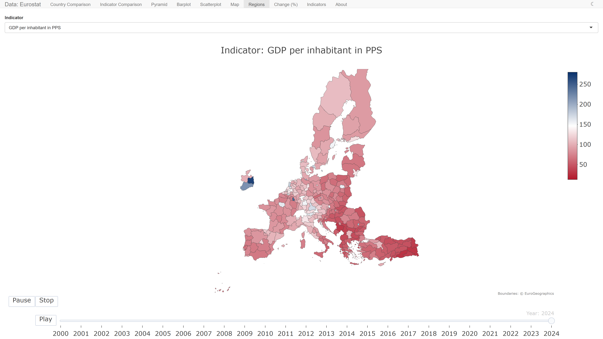
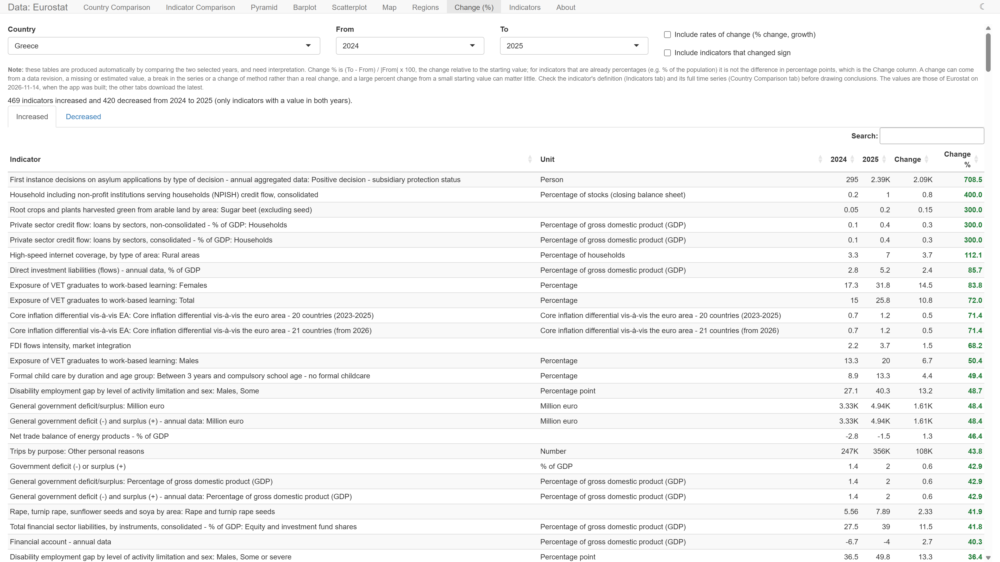
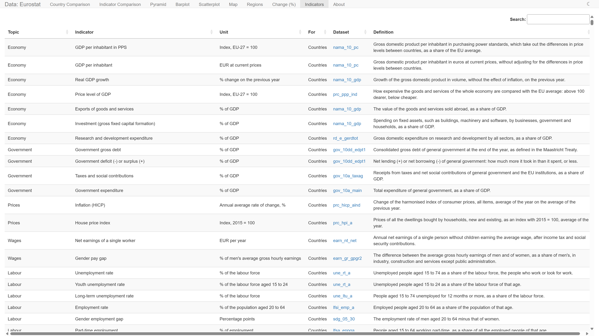

# Eurostat Indicators Explorer

**[Open the live app](https://sedzinfo.shinyapps.io/golemeurostat/)** · [Website](https://sedzinfo.github.io/golemeurostat/)

A Shiny app, built as a golem package, for exploring indicators of [Eurostat](https://ec.europa.eu/eurostat), the statistical office of the European Union: for the 27 countries of the EU, the 4 of EFTA and the 9 candidate countries, with the EU-27 average for comparison, and for the regions of Europe. It follows the design of [golemworldbank](https://github.com/sedzinfo/golemworldbank), and shares its stylesheets and scripts, which both apps load from [sedzinfo.github.io](https://github.com/sedzinfo/sedzinfo.github.io/tree/main/shiny): the layout of the page, on a desktop and on a phone, and the dark mode.

# Tabs
The tabs of golemworldbank, with two maps:

- **Country Comparison**: an indicator over the years for the countries you pick, with the EU-27 average as a dashed line
- **Indicator Comparison**: several indicators over the years for one country, or the EU-27
- **Pyramid**: the population of a country by five-year age group and sex, animated by year
- **Barplot**: the countries ranked by an indicator, as a race through the years, with the country you pick in red
- **Scatterplot**: the countries by two indicators, as bubbles as large as their population, animated by year, with the correlation of the two in each year
- **Map**: the countries colored by an indicator, from red for the lowest through white to dark blue for the highest, animated by year
- **Regions**: the regions of Europe (NUTS 2) colored in the same way by an indicator, such as GDP per inhabitant or unemployment, animated by year
- **Change (%)**: the indicators of a country that rose and fell between two years, by how much: by percent, and those that are percentages, such as the unemployment rate, by percentage points, in tabs of their own
- **Indicators**: every indicator of the app, with its unit, definition and a link to its dataset at Eurostat
- **About**: where the data comes from, the acknowledgments and the license

The lists of countries of Country Comparison, Indicator Comparison and Barplot offer only the countries that have values of the indicator, or indicators, picked, as most indicators have none for Ukraine, Georgia, Moldova or Liechtenstein. A country picked that has none is set aside, and comes back with the next indicator that has values for it.

The indicators are the 62 chosen by hand and, after them, the series of Eurostat's main tables, about 1,500 more, in the groups of Eurostat's themes. Type in a list of indicators to search their names, or the code of a dataset, such as `une_rt_a`.

# Installation
Open RStudio (or an R console) and run:
```r
# Install devtools if you haven't already
install.packages("devtools")
# Install golemeurostat from GitHub
devtools::install_github("sedzinfo/golemeurostat")
```

Without devtools, install the source tarball of the [latest release](https://github.com/sedzinfo/golemeurostat/releases/tag/latest), which is rebuilt from `main` on every change, together with the PDF manual:
```r
install.packages(
  "https://github.com/sedzinfo/golemeurostat/releases/download/latest/golemeurostat_0.0.0.9000.tar.gz",
  repos = NULL, type = "source"
)
```

# Usage
From the package folder:
```r
pkgload::load_all()
run_app()
```
`app.R`, which the deployment runs, starts it with `run_app(analytics = TRUE)`: Google Analytics, through the cookie banner shared with the sites of sedzinfo.github.io, which loads it only after the visitor accepts, and a footer with the Cookie settings and Privacy links, as in golemworldbank. Without it, the app sends nothing.

The data and the charts can also be used from R:
```r
indicators()                       # the catalogue of indicators
unemployment <- get_indicator("unemployment")
plot_country_comp(unemployment, c("EL", "BG", "PT"), "unemployment")
plot_regions(get_regional("r_gdp_pps"), "r_gdp_pps")
```
Eurostat codes the countries with two letters, as ISO does, except Greece, which is `EL`.

# Adding an indicator
The indicators come from two files of `inst/extdata`, with the same columns: `indicators.csv`, written by hand, and `indicators_generated.csv`, written by a script from the catalogue of Eurostat.

## By hand
An indicator added to `indicators.csv` comes first in the lists, under its own topic, and needs no R code:

| Column | Contents |
|---|---|
| `id` | A short name, lower case letters, digits and `_` |
| `level` | `country`, or `region` for the Regions tab |
| `topic`, `name`, `unit` | How the app shows it |
| `dataset` | The code of the Eurostat dataset, such as `une_rt_a` |
| `filters` | The value of each of the other dimensions of the dataset, such as `sex=T;age=Y15-74;unit=PC_ACT`, so that one value is left per country and year |
| `definition` | A sentence for the Indicators tab |

The code of a dataset and of its dimensions are in the [Eurostat data browser](https://ec.europa.eu/eurostat/databrowser/). `check_indicators("your_id")` tries a new row: it reports the countries or regions and the years it has, or what is wrong with it, such as a dimension that Eurostat does not know or one left open, which gives more than one value per country and year. Run `check_indicators()` now and then to check them all, as Eurostat sometimes renames or retires a dataset.

## From Eurostat's main tables
`indicators_generated.csv` holds the series of the [main tables](https://ec.europa.eu/eurostat/web/main/data/database) of Eurostat, its own selection of headline indicators with few breakdowns (codes such as `tps00001`, `tec00115` or `sdg_08_10`). To rebuild it, as Eurostat adds, renames and retires tables, run from the package folder:
```r
source("data-raw/build_indicators.R")
```
The script reads Eurostat's table of contents and the dimensions of every dataset, downloads each main table with yearly data once (about 680 tables, about 10 minutes the first time; the downloads are kept a week in `data-raw/cache`), and writes a row for each series, a combination of the dimensions other than the country and the year, that has values for at least 10 countries, or 50 regions for the Regions tab, up to 2015 or later. A table with more than 10 such series is left out, and so are amounts in national currency, which cannot be compared between countries, and a series that another table already has under the same name. The names come from the titles of the tables and the labels of the codes, and the units from the labels of the units; the topic is the folder of the table in Eurostat's themes. These limits are at the top of the script. Some labels of Eurostat do not describe their series, such as a unit of "Percentage" for amounts or a title in tonnes for values in kilograms, and some tables have no unit at all: `data-raw/corrections.csv` gives the unit, and the name or definition when they are wrong too, for the series of a table or those with a code, such as `unit=RT`, with the reason, and the script says when a correction no longer finds its series. At its end, it runs `data-raw/build_values.R`, which writes `inst/extdata/values.rds`, the values of every indicator of the countries (about 750,000, 1 MB), for the Change (%) tab, `regions.rds` and `pyramids.rds`, the values of every indicator of the regions and the population of each country by age group and sex (0.5 MB together), and `inst/app/www/countries_RG_20M_2024_4326.geojson`, the outlines of the countries of the Map tab.

A generated row that downloads the same as a hand-written one is left out, so to rename or describe a generated indicator better, copy its row to `indicators.csv` and change it there.

# Data
Each indicator is downloaded from the Eurostat API, which needs no key, the first time a tab shows it, and kept on disk for a day, in `tools::R_user_dir("golemeurostat", "cache")`; set `options(golemeurostat.cache_dir = )` to keep it elsewhere. A few values that are plainly wrong in Eurostat's data, such as a share of the population of 933.2% in a year between two of about 94%, are listed in `inst/extdata/errors.csv`, with the reason, and left out for as long as Eurostat gives them; a value more than 1,000 times the median of its year and of its country, in the wrong units, is left out too. The outlines of the countries and regions of the maps, the NUTS 2024 classification, come from [GISCO](https://ec.europa.eu/eurostat/web/gisco): those of the regions are downloaded once, and those of the countries are in the package, with Moldova and Georgia, which the classification leaves out, from GISCO's outlines of the countries. The Change (%) tab, which compares all the indicators of a country at once, uses instead the values written into the package by `data-raw/build_values.R`, and says their date. The same saved values work without internet: `saved_indicator()`, `saved_regional()` and `saved_pyramid()` give them in the shape of `get_indicator()`, `get_regional()` and `get_pyramid()`, and the examples of the charts use them, such as `plot_bar(saved_indicator("unemployment"), "unemployment", country = "EL", top_n = 10)`.

Source of the data: Eurostat. Administrative boundaries: © EuroGeographics.

# Development
Run the tests with `devtools::test()`, which use saved Eurostat answers and need no internet, and the full package check with `devtools::check()`.

# Screenshots


















